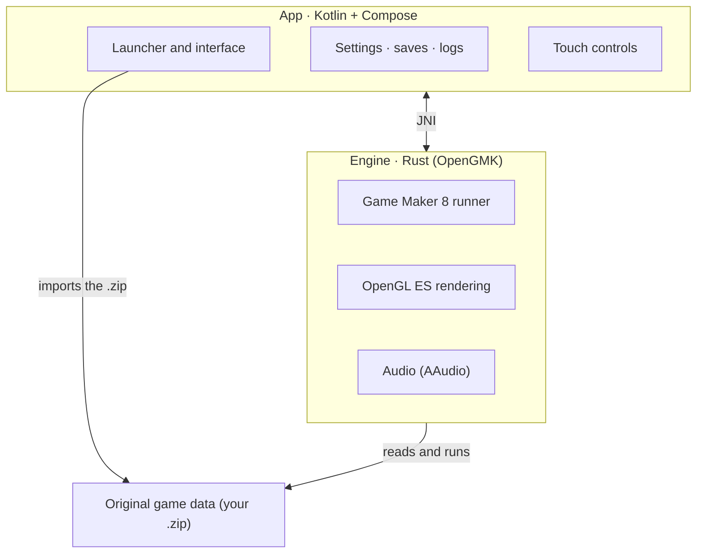

# MAINTENANCE MODE

This application will stop receiving constant updates and will only be updated to fix specific bugs. At some point near the end of the year it will stop receiving full support. This is not the end, but the beginning of a cross-platform project for Windows, Linux, macOS, Android and iOS called **Reloaded OpenGMK**. I'm also announcing that the Pokémon Reloaded Android code is now completely clean of any GML script derivatives. More news about **Reloaded OpenGMK** soon.

# Pokémon Reloaded on Android

[](LICENSE)
[](https://github.com/lionelmendozaparsons020-lab/pokemon-reloaded-android/releases/latest)
[](https://github.com/lionelmendozaparsons020-lab/pokemon-reloaded-android/releases)

Run **Pokémon Reloaded** on Android without a Windows emulator in between. Fork maintained by
[@lionelmendozaparsons020-lab](https://github.com/lionelmendozaparsons020-lab), for the community.
Based on the original Android port by [Klisee](https://github.com/Klisee/pokemon-reloaded-android) (GPL-2.0).

## What this really is

"Port" is a loose term here, so let's clarify. Pokémon Reloaded is a game made in Game Maker 8
for Windows, and here **nothing has been rewritten or recompiled**. What this app does is
**run the original game as-is**, with its files untouched, on top of
[OpenGMK](https://github.com/OpenGMK/OpenGMK): a native Rust reimplementation of the Game Maker 8
engine.

In other words: there is no Wine, no emulated Windows, no translation layer. The engine is
written for Android and compiled for the phone, so the game runs practically as a native. The only
thing that has been "ported" is the engine's internals, not the game.

The app does provide everything outside the game: importing the game from a `.zip`, touch controls,
settings, save management and logs. The game itself is not touched.

## How it works

- **Import.** Tap Import and choose the game's `.zip`. The app unpacks it into its own private
  storage, so it doesn't depend on storage permissions or on where you keep the file.
- **Run.** The engine (OpenGMK, in Rust) is loaded as a native library and starts the Game Maker 8
  runner on the game's data. Rendering goes through OpenGL ES and audio through AAudio.
- **Controls.** The touch layer isn't fixed: it changes with the game's state, so on the map you
  get a D-pad and in menus something else. Each button presses a game key, and you can
  remap any of them from Settings → Gamepad → Controls. A real gamepad also works, detected automatically.
- **Saves.** They are read and written in the game folder. From Settings → Saves you can view them,
  export them, import them, delete them and move one from one slot to another. If you played on PC,
  your save comes in through here.
- **Frames.** In Settings → Frames, **30 FPS (Original)** is the default mode. **60 FPS
  (Experimental)** and **120 FPS (Experimental)** interpolate movement and camera at that rate; the
  120 option is only enabled if the panel advertises 120 Hz or more. **Uncapped FPS** draws as much
  as the phone can and also requires 120 Hz or more. The simulation still runs at 30 steps/s: the
  game doesn't go faster, and sprite animations and logic keep running at 30 Hz. The experimental
  modes use more battery and may fail. On desktop it is chosen with `-R auto`, `-R 60`, `-R 120` or
  `-R uncapped`, and `OPENGMK_RENDER_LOG=1` prints the real draws/s and steps/s.
- **Leaving and returning.** When the app goes to the background, the loop stops and audio is really
  cut; when you return, it continues where it was instead of staying black.
- **Logs.** If something goes wrong, the app writes a log and you can share it as a text file from
  Settings → Logs, without losing it when the phone restarts.

## How it is put together



The app and the engine are two separate worlds that talk through JNI. The engine knows nothing about
Android or the interface: it only knows how to run the game. The app knows nothing about Game Maker:
it only launches and wraps it. That separation lets you touch the interface without breaking the
engine, and vice versa.

## What you need

The game's original files, which are on **F3R**'s blog:
[pokemon-reloaded.blogspot.com](https://pokemon-reloaded.blogspot.com/)

The repo includes no game assets, and that is exactly what keeps it clean.

## How to use it

1. Install the APK from the latest release.
2. Get the game as a `.zip` and tap **Import** (or use **Download** to open the blog).
3. **Play**. If you already had a save on PC, bring it from Settings → Saves.

## Status

It's in beta and it shows: it may crash. If something fails, save a log from Settings → Logs and open
it as an issue.

Already solved:

- **The black screen on phones with a PowerVR GPU** (MediaTek Helio and similar). The engine bound
  the VAO/VBO/program only once and treated the buffer as invalidated after each draw: on deferred
  GPUs (TBDR) that left the vertex processor reading discarded memory and nothing was painted. Now
  they are bound on every draw, the buffer is not invalidated, the `std140` uniform block has the
  correct offsets and atlases are uploaded in batches — with the latter, startup went from ~85 s to
  an instant. Thanks to **Alexpix0 (Armando)**, who found and tested it. (The diagnosis details are
  in the commit history.)
- **Battle scaling**, which left the camera misplaced.
- **The Fly move**, which never connected.
- **Infinite XP** when opening the bag after fainting a Pokémon.
- **The crash in double battles** when switching Pokémon.

What currently causes problems, and I'll fix later:

- **Audio cuts out** on some phones when mixing music and effects.

And to do, in no particular order:

- Add custom images (pixel art) to more touch buttons.
- More performance tuning for modest phones.
- Review compatibility with all kinds of gamepads.

## Building

Each architecture has its own APK (the engine is native). `arm64-v8a` is the default:

```
# The engine (Rust) and its .so for Android
cd src/OpenGMK
cargo ndk -t arm64-v8a --platform 29 build -p gm8emulator --release
cargo ndk -t armeabi-v7a --platform 29 build -p gm8emulator --release
cargo ndk -t x86_64 --platform 29 build -p gm8emulator --release

# The app: one APK per architecture
cd ../../android
./build.sh :app:assembleRelease
./build.sh :app:assembleRelease -PtargetAbi=armeabi-v7a
./build.sh :app:assembleRelease -PtargetAbi=x86_64
./build.sh :app:assembleRelease -PtargetAbi=universal
```

The **universal** one carries all three architectures and works as a catch-all, at the cost of
weighing about 10 MB more.

The `.github/workflows/build-apks.yml` workflow builds all three in CI when a tag is published.

## License

Copyright (C) 2026 Klisee and contributors (original work). Fork modifications: Copyright (C) 2026 lionelmendozaparsons020-lab.

This project is distributed under the **GNU General Public License v2.0** (`GPL-2.0-only`), the same
license as OpenGMK, from which it takes the engine. The full text is in [LICENSE](LICENSE).

The original Pokémon Reloaded files are not part of this repository nor distributed with the APK;
they are the work of F3R Productions and are governed by their own terms. `vendor/udon` is also
GPL-2.0-only, and `vendor/ramen` is distributed under the Zlib license.

## Credits

- **Pokémon Reloaded** is the work of **F3R Productions**: [the game's blog](https://pokemon-reloaded.blogspot.com/)
- **OpenGMK**, the engine reimplementation without which this wouldn't exist: [github.com/OpenGMK/OpenGMK](https://github.com/OpenGMK/OpenGMK)
- **LixarXDX**: for the redesign of the touch controls and the classic controls, the basis of this version's customization.
- **[Kizzy (dead8309)](https://github.com/dead8309/KizzyRPC)**: for KizzyRPC, the method the user-token Rich Presence is based on.
- **[nyxthor-dev](https://github.com/nyxthor-dev)**: for the analysis of the freeze when returning from the background and the proposed fixes ([issue #77](https://github.com/Klisee/pokemon-reloaded-android/issues/77)).
- **Alexpix0 (Armando)**: for the rendering fix that solved the **black screen on phones with a PowerVR GPU** (binding VAO/VBO/program on every draw, removing the buffer invalidation that broke on deferred GPUs, fixing the `std140` uniform block and uploading atlases in batches, which also made startup far faster). [His PR](https://github.com/Klisee/pokemon-reloaded-android/pull/2)
- **Google Sans Flex**, the app's typeface

Pokémon is a trademark of Nintendo, Game Freak and Creatures. This project is not affiliated with or
endorsed by them.
